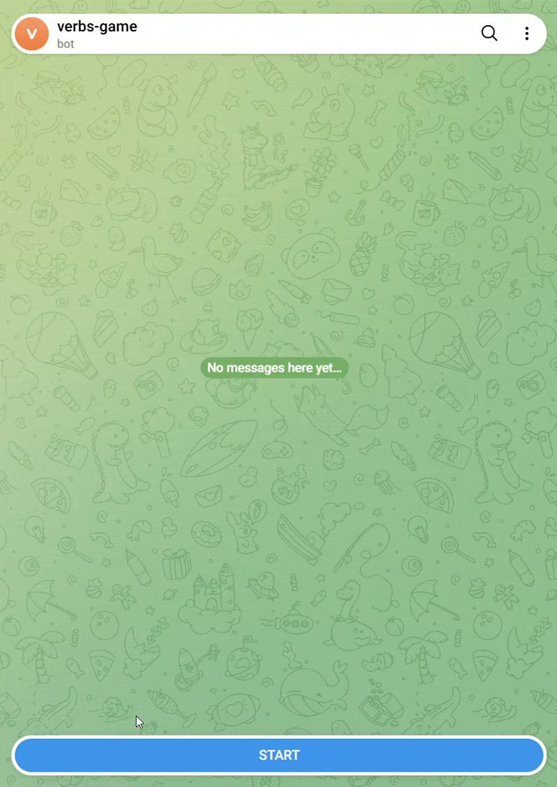

# Обучаемый бот-помощник для Telegram и ВКонтакте

Проект содержит инструменты для создания и запуска интеллектуальных ботов поддержки в мессенджерах Telegram и ВКонтакте на базе искусственного интеллекта **Google Dialogflow**. Бот автоматически отвечает на частые вопросы пользователей (устройство на работу, восстановление пароля, правила сообщества), а в случае неизвестной фразы во ВКонтакте — молчит, уступая место операторам техподдержки.

### Демонстрация и работающие версии

* **Telegram-бот:** [@verbs_game_DO_bot](https://t.me/verbs_game_DO_bot)
* **Группа ВКонтакте:** [vk.ru/test_group](https://vk.ru/club243102611)



---

### Как установить

Для работы ботов требуется **Python 3.10** или выше.

1. Скачайте код проекта и перейдите в папку с ним:
   ```bash
   git clone https://github.com/daschaosipova/verbs_game_bot.git
   cd verbs_game_bot
   ```

2. Установите необходимые зависимости:
   ```bash
   pip install -r requirements.txt
   ```

### Переменные окружения

Для работы скриптов вам понадобятся API-ключи. Создайте в корневой директории проекта файл `.env` и добавьте в него следующие настройки:

```env
TG_TOKEN=Ваш_токен_телеграм_бота
VK_TOKEN=Ваш_токен_группы_вконтакте
PROJECT_ID=ID_вашего_проекта_в_Google_Dialogflow
TG_CHAT_ID=Ваш_Telegram_ID_для_получения_логов_об_ошибках
```

#### Настройка доступа к Google Dialogflow (Важно)
Для авторизации в Dialogflow API необходимо скачать файл с ключами сервисного аккаунта Google Cloud в формате JSON. Путь к этому файлу нужно передать в переменную окружения `GOOGLE_APPLICATION_CREDENTIALS`:
```env
GOOGLE_APPLICATION_CREDENTIALS=path/to/your/google-credentials.json
```
*Ни в коем случае не добавляйте этот JSON-файл в коммиты на GitHub!*

### Как запустить

#### 1. Обучение Dialogflow (Загрузка интентов)
Перед запуском ботов необходимо загрузить базу вопросов и ответов в ваш агент Dialogflow. Убедитесь, что файл с вопросами лежит в корне под именем `questions.json`, и запустите скрипт:
```bash
python upload_intents.py
```

#### 2. Запуск бота в Telegram
```bash
python tg_bot.py
```

#### 3. Запуск бота во ВКонтакте
```bash
python vk_bot.py
```

### Мониторинг и деплой на сервер

* **Уведомления об ошибках:** К обоим ботам подключён кастомный обработчик логов `TelegramLogsHandler` (`tg_logs_handler.py`). При возникновении критических ошибок или падении цикла опроса оба бота мгновенно отправляют полный `Traceback` ошибки администратору в Telegram (в чат `TG_CHAT_ID`).
* **Фоновая работа:** На боевом сервере боты запущены как независимые системные службы `systemd` (`tg-verbs-bot.service` и `vk-verbs-bot.service`) с автоматическим перезапуском при сбоях.

### Цель проекта

Код написан в образовательных целях для онлайн-интенсива [Девман](https://dvmn.org/).


